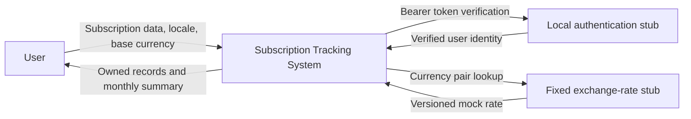

# Sprint 1 integration handoff

This document coordinates Furkan's implementation and integration contribution
with the architect's API design. It describes planned behavior for the first
release. The API, UI, authentication stub, and exchange-rate stub are not
implemented by this contribution.

## Responsibility boundary

The application owns subscription persistence, ownership checks, lifecycle
rules, monthly-equivalent calculations, and UI/API localization. Token
verification and fixed exchange rates are consumed through documented local
stub boundaries. Payment transactions, identity-provider implementation,
notifications, and live-rate retrieval remain outside this release.



## Client and API responsibilities

| Concern | Client | API |
| --- | --- | --- |
| Identity | Send `Authorization: Bearer <token>` | Verify the stub token and derive identity from `sub` |
| Ownership | Never send a user ID as resource ownership | Scope every list, read, write, and total to the authenticated user |
| Subscription input | Send numeric price, original currency, cycle, and offset-aware timestamp | Validate the complete request and assign ACTIVE on creation |
| Language | Persist UI locale in local storage and send `Accept-Language` | Localize error title/detail; keep error code stable |
| Base currency | Send `baseCurrency` on summary requests | Default to TRY and convert each ACTIVE monthly equivalent |
| Refresh | Refetch the summary after successful create, update, or delete | Calculate from the current stored subscriptions |
| Display | Format numeric amounts using `Intl.NumberFormat` for the selected locale/currency | Return JSON numbers, never localized price strings |

The UI locale and base currency are independent. A Turkish interface may display
a USD total, and a TRY dashboard may include subscriptions priced in USD or EUR.
The contract accepts `tr-TR` and `en-US`; when the header is omitted it uses
English. Unsupported locale values return 400 in this draft. Full HTTP
language negotiation is a future design decision.

## Monthly equivalent and mock rates

For each ACTIVE subscription:

```text
monthlyOriginal = price                 when billingCycle = MONTHLY
monthlyOriginal = price / 12            when billingCycle = YEARLY
monthlyBase = monthlyOriginal * tryPerUnit[original] / tryPerUnit[base]
totalMonthlyExpense = roundHalfUp(sum(monthlyBase), 2)
```

Exclude PAUSED and CANCELLED subscriptions. The active count is the number of
ACTIVE records, including a free subscription. Use decimal arithmetic, keep
precision during division/conversion, and round the final sum once. The
renewal month does not restrict the monthly-equivalent calculation.

The fixture [monthly-summary.json](../../api/examples/monthly-summary.json) uses
these synthetic rates, identified as `sprint-1-fixed-v1`:

| Currency | TRY per one unit |
| --- | ---: |
| TRY | 1 |
| USD | 35 |
| EUR | 40 |

These are intentionally fixed test data, not current market exchange rates.
USD 15.99 per month contributes TRY 559.65. TRY 1200 per year contributes TRY
100 per month. Their consolidated monthly equivalent is TRY 659.65, USD 18.85,
or EUR 16.49, with two ACTIVE subscriptions. The fixture's PAUSED and CANCELLED
records contribute nothing.

## Authentication stub boundary

The architect should choose and document the local stub's issuer, signing
mechanism, token acquisition procedure, and test-user identities before backend
implementation. The API must verify tokens rather than trust decoded claims
without verification. Base currency does not come from a required token claim;
it is an explicit summary query parameter.

A missing or invalid token returns 401 and a Bearer challenge. A missing record
and a foreign user's record both return the same 404 problem representation.
Secrets and real personal credentials must not be committed.

## Error and lifecycle behavior

| Situation | HTTP | Stable code |
| --- | ---: | --- |
| Invalid request body or field | 400 | `INVALID_INPUT` |
| Unsupported currency | 400 | `INVALID_CURRENCY` |
| Missing or invalid authentication | 401 | `UNAUTHORIZED` |
| Missing or foreign subscription | 404 | `SUBSCRIPTION_NOT_FOUND` |
| Duplicate subscription name for the same user | 409 | `DUPLICATE_SUBSCRIPTION` |

Use `application/problem+json`. The API error `status` must equal the HTTP
status. Supported-language errors include `Content-Language`. The code remains
the same in Turkish and English. DELETE returns 204 without a body; PATCH to
CANCELLED keeps the record. PATCH is partial, accepts at least one supported
field, and does not use null to clear required data.

## Handoff to later implementation

The report's initial implementation order is subscription creation, then the
monthly summary. This document supplies the contract and calculation examples
for that work. Actual duplicate detection, user isolation, currency conversion,
and UI behavior require backend/UI integration tests when those components
exist; the current contract checks do not prove those runtime behaviors.
